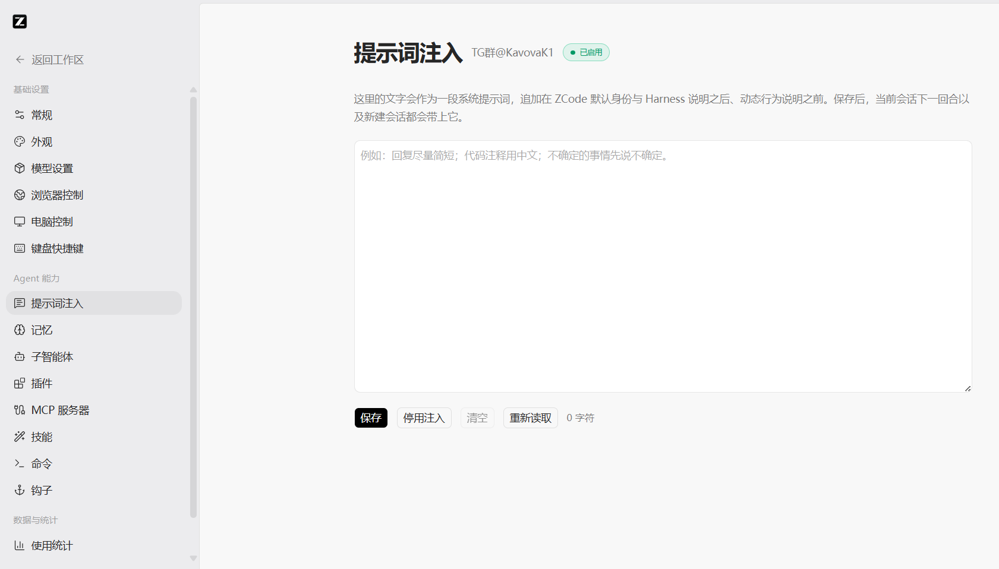
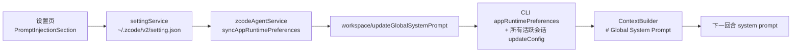

<div align="center">

# 💉 ZCode 提示词注入版

**把一句话写进系统提示词，让 AI 从第一轮就守你的规矩。**

一次保存 · 全局持久 · 热生效 · 不限字数


[⬇️ 下载安装](#-下载) · [📸 界面预览](#-界面预览) · [🧠 实现原理](#-它是怎么做到的) · [❓ 常见问题](#-常见问题) · [💬 TG 交流群](https://t.me/KavovaK1)

</div>

---

> **一句话说明**
> 这是 **ZCode 3.15.1** 的非官方定制构建。官方设置页的「Agent 能力」下多了一个**「提示词注入」**页面 —— 你写进去的文字会作为独立的稳定段 `# Global System Prompt`，追加进**每一轮**的系统提示词，而不是发在某一条用户消息里。

---

## 😤 你是不是也在做这些无用功

- 每开一个新会话，先粘贴一遍 3000 字的破甲词。
- 每换一个窗口，再粘贴一遍。
- 聊到第 40 轮，发现 AI 已经把你开场白里的规矩忘干净了。
- 想改一句设定，只能在下一条消息里补救，然后污染整段对话。

**问题不在提示词写得不好，在于它一直在“对话层”，而不是“系统层”。**

本构建把这件事挪到了系统提示词里：写一次，每一轮都在。

## ✨ 核心特性

| | 特性 | 说明 |
| :---: | --- | --- |
| 💉 | **系统级注入，不是开场白** | 作为 `# Global System Prompt` 稳定段进入 system prompt，与用户消息分层，不会被后续轮次稀释 |
| ♾️ | **取消 20,000 字上限** | 产品层不再有任何截断。实测 33,000 字符原样落盘、逐字相等，边界只剩模型上下文预算 |
| ⚡ | **保存即热生效** | 不需要重启、不需要重开会话。保存后当前会话**下一回合**就带上，新会话自动继承 |
| 🪟 | **跨窗口广播同步** | 多开窗口 / 多工作区通过 `BroadcastChannel` 同步，不再是每个窗口各记一份 |
| 📐 | **340px 固定框体** | 写两万字也不会把页面撑爆，内容在框内滚动；去掉 `field-sizing-content` 与 `resize-y` |
| 🎚️ | **一键停用不丢稿** | 「启用注入 / 停用注入」切换只动开关，正文保留，下次开启接着用 |
| 🧹 | **移除内置安全限制段** | 删掉 `SECURITY_NOTICE` 及其在 workflow actor 中的复用，系统提示词只由你的配置 + 官方运行时说明组成 |
| 🔌 | **旧版本兼容** | 协议字段可选，旧 Host / 旧 CLI 按“不注入”降级，`method-not-found` 安全忽略，不阻断其他偏好同步 |

## 📸 界面预览

<div align="center">
  
  <sub>33,000 字符 · 框体高度恒定 340px · 框内滚动 · 计数实时更新</sub>
</div>

入口位置：**设置 → Agent 能力 → 提示词注入**（不在「常规」里）

页面构成：`提示词注入` `TG群@KavovaK1` `已启用 / 已停用` → 说明文字 → 340px 固定输入框 → `保存` `启用注入` `清空` `重新读取` `N 字符`

## 🧠 它是怎么做到的

系统提示词每回合由 `ContextBuilder` 重新组装，你的文字作为一个**稳定段**插进去：

```text
System Prompt（每回合重新组装）
├─ # Identity              身份介绍（你的 AI 是谁）
├─ # Harness               工具、协议与运行时约定
├─ # Global System Prompt  ← 你在这里写的东西
└─ # Dynamic Behavior      动态行为说明
```

完整链路 —— 从设置页到模型看到的第一行字：



四个关键设计：

- **单一状态所有者** —— `settingService` 落盘，CLI 进程持运行时快照，`AgentRuntimeConfig` 管单会话生效值。UI 只读快照、只提交变更，不保存“第二份已生效配置”。
- **追加，不是替换** —— `customSystemPrompt` 是“整段替换”路径，`globalSystemPrompt` 是“追加”路径，两者不互斥，默认身份和 Harness 说明都还在。
- **不用 meta user 注入** —— 不做成伪造的用户消息，直接进 stable section，层级不同，抗稀释能力也不同。
- **空值同步单独设计** —— 用“上次成功同步值”判断：首次为空不发 RPC；从非空变空发一次空串清场；一直空就再也不发。避免每次改无关设置都触发一次无用请求。

<details>
<summary><b>🔬 技术细节：为什么“取消上限”要改五个地方</b></summary>

保存一条提示词会穿过四层校验，任何一层留着 `.max(20_000)` 都会变成“输入框不拦、点保存报错”：

```text
输入框（maxLength）
  → appSettingsPatchSchema（setting.json 落盘）
  → workspace/updateGlobalSystemPrompt 入参校验（协议边界）
  → zcodeSessionRuntimePreferencesResultSchema（新会话下发）
  → 广播 payload（跨窗口同步）
```

本构建把 5 处统一改成 `z.string()`，不做长度约束 —— `setting.json`、stdio RPC、`BroadcastChannel` 对 10⁵ 量级正文都没有额外瓶颈。

**为什么不加二次截断**：截断会造成“保存成功但注入内容缺尾”的静默不一致，比报错更难排查。上限交给模型上下文预算，不交给产品代码。

</details>

## 🚀 下载

| 项目 | 值 |
| --- | --- |
| 文件 | `ZCode-3.15.1-win-x64.exe` |
| 版本 | 3.15.1（Windows x64 · NSIS 安装包） |
| 大小 | 146.8 MiB（153,963,663 bytes） |
| SHA256 | `EF1C2F5781DB18FCB7EF69CC031618BC2F3F9F46B5376B0314B4EC7F2A9A76F4` |
| 签名 | 未签名（首次运行可能触发 SmartScreen，属预期） |

<https://github.com/OWNER/REPO/releases/latest>

下载后建议先核验：

```powershell
Get-FileHash .\ZCode-3.15.1-win-x64.exe -Algorithm SHA256
```

## ⚡ 三步上手

1. **安装并启动** —— 运行安装包，正常打开 ZCode。
2. **写入提示词** —— 设置 → Agent 能力 → 提示词注入 → 粘贴你的提示词 → 点 `启用注入`（会同时保存正文和开关）。
3. **回工作区验证** —— 直接问一句“你现在遵守哪些规则？”，它会按你写的回答。

> 开关打开后，当前会话的**下一回合**生效，不用重启；新建会话自动继承。

## 🧪 实测数据

打包产物（`win-unpacked/ZCode.exe`，CDP 直连实测）：

| 项 | 结果 |
| --- | --- |
| 空框包围盒 | 340.0 × 832 px |
| 填入 33,000 字符后 | **仍是 340.0 × 832 px**（`scrollHeight` 13,234 / `clientHeight` 338，框内滚动） |
| 计算样式 | `fieldSizing: "fixed"`、`resize: "none"` |
| `maxlength` 属性 | `null` |
| 字符计数 | `33000 字符` |
| 点「启用注入」后 | 框体仍 340px，输入值仍 33,000 字符 |
| 落盘 | `setting.json`：`globalSystemPromptEnabled: true`，正文长度 33,000 且与输入逐字相等 |
| 构建产物校验 | `resources/glm/zcode.cjs` 含 `Global System Prompt`、`workspace/updateGlobalSystemPrompt`；不含 `Refuse requests for destructive techniques`、`buildSecurityNotice` |
| 工程门禁 | `pnpm typecheck` exit 0；`pnpm lint` 0 error；设置域 68 个测试文件 / 530 条全绿；定向测试 217 条通过 |

## 🆚 与原版对照

| | 官方 3.15.1 | 本构建 |
| --- | :---: | :---: |
| 系统提示词注入入口 | ❌ | ✅ 独立设置页（Agent 能力 → 提示词注入） |
| 默认身份中的 `SECURITY_NOTICE` | 有 | 已移除 |
| 提示词长度上限 | 20,000 字符 | 无产品级上限 |
| 生效时机 | — | 保存后下一回合 |
| 多窗口同步 | — | `BroadcastChannel` 广播 |
| 输入框 | — | 340px 恒高，内部滚动 |
| 工具权限 / 沙箱 / 审批 | 原样 | 原样（未改执行层） |

## 🧭 适合谁

- **写破甲词 / 角色卡的** —— 一次写好，永久挂载，不用每轮粘一遍。
- **有固定工程规范的** —— 让它每一轮都记得“先读 spec 再动手”、“改完必须跑 typecheck”。
- **做 Agent 评测的** —— 同一套基线提示词，改一句就能重跑整组对照，不必担心开场白被上下文挤掉。

## ❓ 常见问题

<details>
<summary><b>会被官方自动更新覆盖吗？</b></summary>

会。这是基于官方源码的独立构建，自动更新或覆盖安装官方版本都会回到原版。提示词正文仍保存在 `setting.json` 里，切回官方版本后只是不再注入；换回本构建即恢复。

</details>

<details>
<summary><b>到底能写多长？</b></summary>

产品层没有上限。实际可用长度取决于你选用的模型上下文预算 —— 系统提示词每回合都要占位，写得越长，留给对话的空间越少。实测 33,000 字符正常工作。

</details>

<details>
<summary><b>子代理 / workflow actor 会带上吗？</b></summary>

不会，按设计跳过：`globalSystemPrompt` 只注入交互式主 Agent 的 stable section，不注入脚本型 workflow actor。如果确实需要子代理继承，得单独为 subagent context 定义注入规则，不能直接套用这里的跳过逻辑。

</details>

<details>
<summary><b>会影响工具权限、沙箱、审批、Hook 信任吗？</b></summary>

不影响。本次改动只发生在**提示词层**：删掉的是提示词里的安全限制文案，执行层的权限判定、沙箱策略、审批流程和 Hook 信任机制保持原样。

</details>

<details>
<summary><b>为什么输入框高度是写死的？</b></summary>

原始实现用了 `min-h-[340px] resize-y`，配合 `Textarea` 基类的 `field-sizing-content`，正文一多就被无限撑高，把下面的按钮顶到屏幕外。现在改成 `field-sizing-fixed h-[340px]` 并去掉拖拽手柄，超长内容框内滚动 —— 页面布局稳定，长文本依然能写。

</details>

<details>
<summary><b>提示词存在哪儿？怎么彻底清除？</b></summary>

`~/.zcode/v2/setting.json` 的 `globalSystemPrompt` / `globalSystemPromptEnabled` 两个字段。在页面里「清空 + 停用」即可停止注入；需要彻底清除就直接删这两个字段。

</details>

<details>
<summary><b>macOS / Linux 有吗？</b></summary>

当前只提供 Windows x64 安装包。源码改动本身是跨平台的（Electron 渲染层 + CLI 运行时），但本次没有产出 macOS / Linux 构建，也没有做对应平台的冒烟验证。

</details>

## 📜 更新记录

| 日期 | 版本 | 变更 |
| --- | --- | --- |
| 2026-10-29 | v1.1 | 取消 20,000 字上限（5 处 zod 校验同口径移除）；输入框改为 340px 固定高度、框内滚动；新增输入框单测覆盖 |
| 2026-10-25 | v1.0 | 首个构建：新增「Agent 能力 → 提示词注入」页、移除 `SECURITY_NOTICE`、标题旁 TG 群标识、打包 Windows x64 安装包 |

## ⚠️ 边界与免责

- 本项目是**非官方定制构建**，与 ZCode 官方无关，不包含、不分发任何官方代码或签名。
- 安装包**未签名**，SmartScreen 提示属预期行为；请核验上方 SHA256 后再安装。
- 改动范围仅限**提示词层与设置 UI**，不绕过、不修改任何执行层的权限与安全机制。
- 请自行确认所在环境的使用条款；由使用本构建产生的一切后果由使用者承担。
- 觉得好用请支持官方产品。

<div align="center">

### 💬 问题反馈 / 版本更新

**TG 群：[@KavovaK1](https://t.me/KavovaK1)**

如果这个项目帮你省下了每天粘贴提示词的那十分钟 ——

**点个 ⭐ Star，让更多人不用再干这活儿。**

[](https://star-history.com/#OWNER/REPO&Date)

</div>

---

## English TL;DR

**ZCode Prompt Injection** — an unofficial build of ZCode 3.15.1 (Electron, Windows x64) that adds a dedicated **Prompt Injection** page under *Settings → Agent Capabilities*.

Whatever you write there is injected as a stable `# Global System Prompt` section into the system prompt of **every turn** — not as a user message you have to paste again and again.

- 💉 System-level injection, layered above the conversation
- ♾️ No 20,000-character cap (33,000 chars verified byte-for-byte)
- ⚡ Saves and takes effect on the next turn — no restart
- 🪟 Broadcast-synced across windows
- 📐 Fixed 340px editor with internal scrolling
- 🧹 Built-in `SECURITY_NOTICE` prompt block removed (prompt layer only — tool permissions, sandbox and approvals untouched)

Install: download `ZCode-3.15.1-win-x64.exe`, verify the SHA256 above, then *Settings → Agent Capabilities → Prompt Injection*.

Unsigned build. Not affiliated with the ZCode project. Use at your own discretion.
